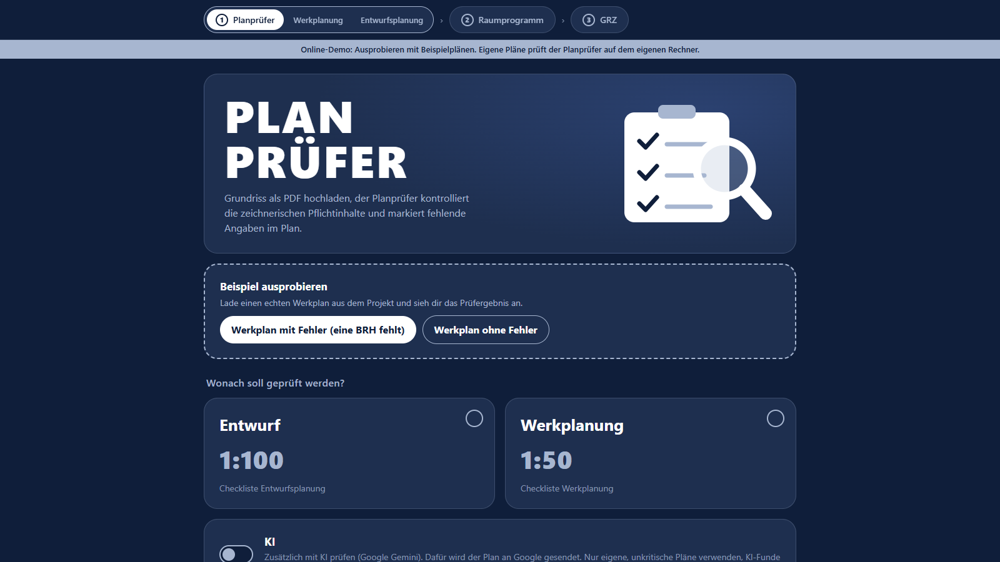
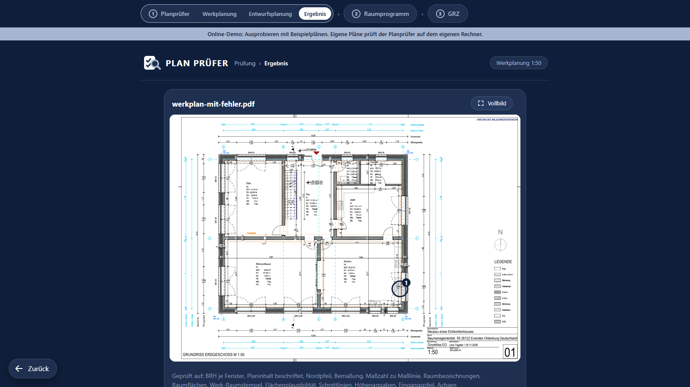

# plan-pruefer

**Der Planprüfer prüft Grundrisse aus ArchiCAD (PDF) auf die zeichnerischen Pflichtinhalte, markiert fehlende Angaben direkt im Plan und vergleicht den Entwurf mit Raumprogramm und GRZ.**

**Live-Demo:** [jade-hs-vibecoding-wpk.github.io/plan-pruefer](https://jade-hs-vibecoding-wpk.github.io/plan-pruefer/) (zum Ausprobieren mit Beispielplänen, eigene Pläne prüft das Programm auf dem eigenen Rechner)

| Startseite | Prüfergebnis eines Werkplans |
|---|---|
|  |  |

## Idee

Der Planprüfer ist eine Web-App für Architekturstudierende. Man lädt einen Grundriss als PDF hoch (Export aus ArchiCAD) und bekommt eine Liste mit Befunden zurück.

Die Prüfpunkte wachsen Schritt für Schritt. Die Einzelheiten stehen in [PRUEFKATALOG.md](PRUEFKATALOG.md), der Zeitplan in [PLAN.md](PLAN.md).

### Was der Planprüfer können soll

**Eingabe**
- Zunächst nur **Grundrisse** als PDF aus ArchiCAD mit auslesbarem Text.
- Später: Schnitte, Ansichten und ganze Plansätze. IFC-Dateien kommen als Erweiterung, vor allem für Maße und Rechenwerte.

**Gruppe A: zeichnerische Pflichtinhalte (zuerst)**
- Nordpfeil vorhanden
- Bemaßung: Gesamtmaße, Außenmaßketten, Raummaße innen, Öffnungsmaße
- Raumbezeichnungen: Jeder Raum hat einen Namen
- Raumflächen: Jeder Raum hat eine Fläche, und die Angabe ist plausibel
- Schnittlinien: mindestens ein Schnitt, Beschriftung an beiden Enden, Blickrichtung
- Höhenangaben: Fußbodenhöhe je Geschoss und an Raumebenen

**Danach**
- Gruppe B: Maße und Vorschriften (zum Beispiel Türbreiten, Flure, Treppen, Fluchtwege)
- Gruppe C: Rechenwerte (zum Beispiel Summe der Raumflächen, NGF/BGF)
- Gruppe D: Abgleich mehrerer Pläne und Vollständigkeit des Plansatzes
- Abgabekriterien der Hochschule (Entwurfszeichnungen, Werkplanungen) und Bauordnung

**Ergebnis**
- Eine Liste mit Befunden, die man abhaken kann, sobald der Fehler korrigiert ist.
- Markierungen direkt im Plan an der Stelle des Befunds.

**Technik (grob)**
- Feste Regeln für alles, was sich aus dem Text des PDFs ergibt.
- KI für Zeichnungen, die sich nicht anders prüfen lassen (zum Beispiel der Nordpfeil). Gewählt ist Google Gemini im kostenlosen Zugang, als austauschbarer Baustein. Dabei dürfen nur eigene, unkritische Studienpläne gesendet werden.

## App starten

Doppelklick auf `Planpruefer-starten.cmd`. Das Fenster offen lassen, der Browser öffnet `http://localhost:8080`.

## KI-Prüfung einrichten (optional)

Manche Prüfungen, zum Beispiel "Raum ohne Name und Fläche", macht eine KI (Google Gemini). Sie ist standardmäßig **aus** und muss bei jedem Upload ausdrücklich eingeschaltet werden.

**Jede Nutzerin, jeder Nutzer braucht einen eigenen Schlüssel.** Die App benutzt nie einen Schlüssel, der auf dem Rechner liegt (`schluessel.txt`, `schluessel.env`, `.env` oder `GEMINI_API_KEY`). So kann nach der Veröffentlichung niemand den Schlüssel des Teams verbrauchen.

1. Auf [Google AI Studio](https://aistudio.google.com/apikey) mit einem Google-Konto einen kostenlosen API-Schlüssel erstellen.
2. Auf der Startseite die KI einschalten. Darunter erscheint das Feld "Eigener Gemini-Schlüssel": den Schlüssel einfügen und mit "Prüfen" testen. Dabei geht nur der Schlüssel an Google, kein Plan.
3. Prüfung starten. Ist die KI an, aber kein Schlüssel eingetragen, startet die Prüfung nicht und die Seite zeigt auf das Feld.

So geht der Schlüssel mit:
- Er geht nur bei eingeschalteter KI und nur mit der jeweiligen Prüfung an den Planprüfer-Server und von dort an Google. Der Server speichert ihn nicht und schreibt ihn in kein Protokoll. Er gilt nur für diese eine Prüfung.
- "In diesem Browser merken" ist standardmäßig aus. Angehakt liegt der Schlüssel im Speicher dieses Browsers (localStorage), bis der Haken wieder entfernt wird. Auf fremden oder gemeinsam genutzten Rechnern nicht anhaken.
- Eine Datei `schluessel.txt` oder `schluessel.env` im Projektordner wird von der App nicht mehr gelesen. Sie kann gelöscht werden.

Wichtig:
- Den eigenen Schlüssel nicht weitergeben. Schlüsseldateien (`schluessel.txt`, `.env`) stehen weiterhin in der `.gitignore` und werden nie hochgeladen.
- Bei eingeschalteter KI wird der Plan an Google gesendet. Im kostenlosen Zugang darf Google die Eingaben zur Verbesserung seiner Produkte nutzen. Deshalb nur eigene, unkritische Pläne verwenden.
- KI-Funde sind **Hinweise** und müssen von einem Menschen geprüft werden. Bei eingeschalteter KI erzeugt die Seite ein Bild der Planseite und lädt dafür die Bibliothek pdf.js von cdnjs.cloudflare.com (Internet nötig). Die KI-Prüfungen sind **experimentell**: Sie können Fehler übersehen oder falsch melden und brauchen mit dem stärkeren Modell bis zu eine Minute pro Plan.
- Der kostenlose Zugang hat Mengenlimits. Ist das Limit erreicht, zeigt die App eine Meldung, und die normalen Prüfungen laufen weiter.

## Online-Demo (GitHub Pages)

Unter **https://jade-hs-vibecoding-wpk.github.io/plan-pruefer/** liegt eine Demo zum Ansehen und Ausprobieren.

- **Was geht:** Beispielpläne aus dem `Testordner` prüfen (Werkplan mit und ohne Fehler, Raumprogramm, GRZ mit Lageplan) mit den echten Ergebnissen, und der GRZ-Prüfer mit eigenen Zahlen ("Manuell eingeben") vollständig.
- **Was nicht geht:** eigene Pläne prüfen und die KI. GitHub Pages liefert nur feste Dateien aus, der PowerShell-Server läuft dort nicht. Eigene Pläne prüft das Programm auf dem eigenen Rechner (`Planpruefer-starten.cmd`).
- **So entsteht sie:** Bei jedem Push auf `main` stellt der Ablauf `.github/workflows/pages.yml` die Seite zusammen: `pruefung/web` (unverändert), dazu `demo/demo.js` (beantwortet die Server-Anfragen mit den aufgezeichneten Ergebnissen aus `demo/antworten.json`) und die Beispielpläne aus `Testordner/`.
- **Ergebnisse neu aufzeichnen** (nötig, wenn sich eine Prüfung ändert): lokalen Server starten und die Beispielpläne an `/pruefen`, `/raeume` und `/grz-grundriss` schicken, die Antworten in `demo/antworten.json` speichern (siehe `STAND.md`, Abschnitt "Online-Demo").
- **Einmalig in GitHub:** Settings > Pages > Source: "GitHub Actions".

## Ordner

| Ordner / Datei | Inhalt |
|----------------|--------|
| `pruefung/` | Server, Weboberfläche und die Prüfpunkte |
| `testplaene/` | Beispielpläne für die Grundriss-Prüfung, getrennt nach `entwurf/` und `werk/` (nur lokal, nicht im Git) |
| `unterlagen/` | Hochschul-Dokumente (nur lokal, nicht im Git) |
| `archiv/plankopf/` | Erster Testlauf: Plankopf-Prüfung, nicht mehr Teil der App |
| `archiv/testplaene/` | Die Testpläne zur Plankopf-Prüfung (nur lokal, nicht im Git) |

### Offene Punkte

- Welche Bauordnung (Bundesland) gilt, ist noch nicht festgelegt.
- Die Kriterien der Hochschule müssen aus den Dokumenten für Entwurfszeichnungen und Werkplanungen herausgefiltert werden.

## Quellen und Lizenzen

| Was | Herkunft | Lizenz / Rechte |
|---|---|---|
| Code des Planprüfers (`pruefung/`, `demo/`, Abläufe) | Team der Vibecoding KI-Werkstatt, Jade Hochschule | MIT-Lizenz, siehe [LICENSE](LICENSE) |
| pdf.js 3.11.174 (zeichnet die Pläne im Browser, liest Raumprogramme) | Mozilla, geladen von cdnjs.cloudflare.com, nicht im Repository | Apache License 2.0 |
| Google Gemini (optionale KI-Prüfung, Modell `gemini-3.8-flash`) | Google, Gemini API | Nutzungsbedingungen von Google. Im kostenlosen Zugang darf Google die Eingaben verwenden. Jede Person nutzt ihren eigenen Schlüssel. |
| Arbeitshilfe GRZ/GFZ (Grundlage der GRZ-Rechnung) | Bauaufsicht Frankfurt am Main, Stand Oktober 2014, in `grz-gfz/` | Rechte beim Herausgeber. Liegt zu Studienzwecken im Repository. Vor einer Weitergabe außerhalb des Studiums klären, ob das erlaubt ist. |
| Baunutzungsverordnung (BauNVO), Fassungen 1962, 1968, 1977, 1990 | Bundesrecht | Amtliches Werk, gemeinfrei (§ 5 UrhG) |
| DIN 1356-1 (Bauzeichnungen), DIN 406 (Maßeintragung) | DIN | Nur als Grundlage der Prüfregeln genannt, nicht im Repository. Normen sind urheberrechtlich geschützt. |
| Abgabekriterien Entwurf und Werkplanung | Jade Hochschule | Nur lokal (`unterlagen/`), nicht im Repository |
| Beispielpläne (`Testordner/`, `testplaene/`) | Eigene Studienpläne des Teams, gezeichnet mit ARCHICAD Bildungsversion (Graphisoft) | Rechte beim Team. Die Bildungsversion erlaubt keine gewerbliche Nutzung. Im Plankopf stehen Name und Adresse. |
| Screenshots (`docs/screenshots/`) | Aus der Live-Demo, automatisch aufgenommen mit Microsoft Edge | Wie der Code (MIT) |
| Schrift und Symbole | Systemschrift des Geräts (Segoe UI, system-ui), Symbole als eigene SVG-Zeichnungen | Keine fremden Schriften oder Icon-Pakete |
| GitHub Actions (`actions/checkout`, `configure-pages`, `upload-pages-artifact`, `deploy-pages`) | GitHub | MIT-Lizenz |

## KI-Nutzung

**Bei der Entwicklung:** Der Code, die Tests und große Teile der Dokumentation (`README.md`, `STAND.md`, `PRUEFKATALOG.md`) sind mit **Claude** von Anthropic entstanden, über Claude Code in der Claude-Desktop-App (unter anderem mit den Modellen Claude Sonnet 5.5 und Claude Opus 5.5).
- **Vom Team kamen:** die Idee, die Prüfpunkte und alle fachlichen Entscheidungen (zum Beispiel was als Fehler gilt, Schwellenwerte, Verzicht auf die Innenmaße), die Beispielpläne, das Design (Skizzen und Farben) und die Abnahme jeder Funktion.
- **Von der KI kamen:** die Umsetzung in Code, Vorschläge zu Aufbau und Darstellung, die Auswertung der Arbeitshilfe GRZ/GFZ und die Selbsttests.
- **Geprüft wird mit:** einem Testlauf mit 137 Prüfungen (`pruefung/testlauf.ps1`) an echten Plänen und nachgestellten Fehlern, dem Rechenkern der GRZ gegen die Berechnungsbeispiele der Arbeitshilfe und dem Durchklicken durch das Team.

**In der App:** Die Prüfungen laufen ohne KI nach festen Regeln. Nur die Prüfung "Raum ohne Name und Fläche" (A3K) nutzt auf Wunsch Google Gemini. Sie ist standardmäßig aus, braucht einen eigenen Schlüssel, sendet den Plan an Google und liefert nur **Hinweise**. Ein Versuch, auch die Brüstungshöhen per KI zu prüfen, war unzuverlässig und wurde durch eine Regel ohne KI ersetzt.